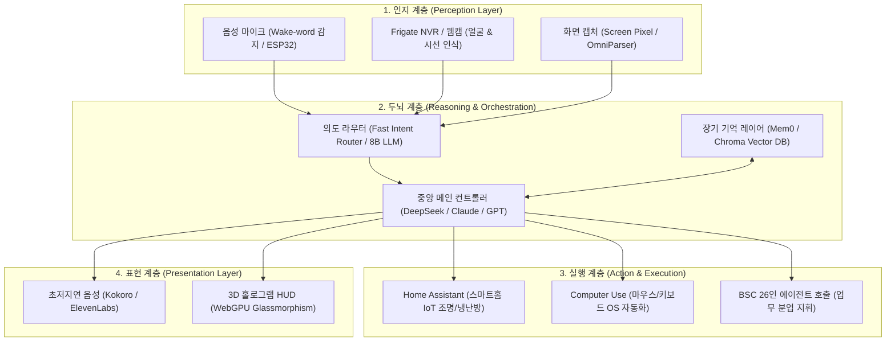

# 🛰️ [BSC 전략보고서] 국내·해외 자비스(J.A.R.V.I.S.) 시스템 딥리서치 및 차세대 UI/UX 시안 보고서


> **문서 번호**: BSC-REP-20261023-JARVIS  
> **보고 일자**: 2026-10-23  
> **수신**: 이건우 대표님 (CEO)  
> **발신**: 수석비서 소하 (Chief Secretary) & AI 전략 연구팀  
> **보안 등급**: 본사 대외비 (BSC Internal Confidential)  
> **핵심 키워드**: 자비스(JARVIS), 자율 에이전트, Home Assistant, Computer Use, 멀티모달 오케스트레이션, HUD UI/UX

---

## Ⅰ. 총괄 개요 (Executive Summary)

영화 속 '자비스(J.A.R.V.I.S. - Just A Rather Very Intelligent System)'는 단순한 질의응답 챗봇이 아닌, **① 청각/시각 실시간 인지(Perception)**, **② 자율 판단 및 도구 오케스트레이션(Brain/Reasoning)**, **③ 물리/디지털 환경 직접 제어(Action/Control)**, **④ 자연스러운 저지연 대화 및 홀로그램 시각화(Presentation)**가 완벽히 결합된 궁극의 AI 에이전트 시스템입니다.

현재 전 세계 자비스 시스템의 진화는 크게 4가지 국면으로 전개되고 있습니다:
1. **빅테크/기업 진영**: OS 직접 조작(Anthropic Computer Use, MS UFO) 및 초저지연 감정 음성 대화(OpenAI Advanced Voice, Hume AI EVI) 중심
2. **글로벌 오픈소스 진영**: 클라우드 종속을 탈피한 100% 로컬 프라이빗 자비스(Ollama + Home Assistant + Frigate + Piper/Kokoro)
3. **국내외 유튜버/메이커 진영**: 아두이노/라즈베리파이/ESP32 및 물리적 아이언맨 헬멧 HUD와 스마트홈 연동 실사판 제작
4. **국내 기업 진영**: 통화·메모·일정 연동 개인 비서(SKT 에이닷) 및 온디바이스 스마트홈 허브(LG ThinQ ON, 삼성 Bixby)

---

## Ⅱ. 자비스 10대 핵심 기능별 대시보드 시안 이미지 (10 Dashboard UI/UX Suite) & 카메라 제스처 OS

이건우 대표님의 지시에 따라 앞서 조사한 국내외 59개 자비스 생태계의 핵심 기능들을 실질적인 **10대 전문 대시보드 시안 이미지**로 구현하였으며, 웹캠 비전(MediaPipe 21-Keypoint)으로 **인식(Hover) · 클릭(Pinch) · 드래그 이동(Drag) · 3D 회전(Rotate)**이 실제로 작동하는 인터랙티브 공간 대시보드([BSC_JARVIS_Camera_Gesture_OS.html](file:///C:/Users/USER/.gemini/antigravity/brain/d66ddba7-271c-45c7-986c-d1fb11c792a8/BSC_JARVIS_Camera_Gesture_OS.html))를 함께 구축하였습니다.

````carousel
### [시안 01] 마스터 홀로그래픽 커맨드 센터 (Master Command Center HUD)
- **기반 레퍼런스**: Iron Man J.A.R.V.I.S. / BSC HQ 통합 관제
- **핵심 기능**: 중앙 3D 아크 리액터 코어, 실시간 신경망 토폴로지, 전체 시스템 헬스 게이지, 글래스모피즘 플로팅 위젯 통합 제어

<!-- slide -->
### [시안 02] 멀티에이전트 오케스트레이션 매트릭스 (Multi-Agent Matrix)
- **기반 레퍼런스**: Microsoft JARVIS (HuggingGPT), CrewAI, AutoGen
- **핵심 기능**: 3D 홀로그램 뉴럴 스피어, 26인 전문 하위 에이전트 자율 태스크 라우팅, 에이전트 간 실시간 통신 및 메모리 할당 매트릭스

<!-- slide -->
### [시안 03] 카메라 비전 핸드 제스처 제어 대시보드 (Spatial Camera Gesture UI)
- **기반 레퍼런스**: MediaPipe Hands 21-Keypoints, 공간 컴퓨팅 비전 UI
- **핵심 기능**: 실시간 카메라 손 관절 스켈레톤 인식, 엄지-검지 핀치 클릭(Pinch Click), 허공 드래그 패널 이동(Drag Move), 손바닥 비틀기 3D 회전(Palm Twist Rotate)

<!-- slide -->
### [시안 04] 자율 OS & 브라우저 제어 대시보드 (Computer Use & OmniParser)
- **기반 레퍼런스**: Anthropic Computer Use, Microsoft UFO & OmniParser, Open-Interpreter
- **핵심 기능**: 화면 UI 버튼 바운딩 박스 자동 인식, 자율 마우스 커서 궤적 시각화, 로컬 파이썬/터미널 샌드박스 실행 로그 및 멀티스텝 작업 큐

<!-- slide -->
### [시안 05] 스마트홈 IoT & Frigate 비전 보안 대시보드 (Smart Home & NVR)
- **기반 레퍼런스**: Home Assistant Core, Jarvis-AIO (HACS), Frigate NVR, LG ThinQ ON
- **핵심 기능**: 3D 아이소메트릭 스마트 하우스 평면도, 실시간 CCTV 안면/객체/택배 AI 감지, 공간별 조명·공조 슬라이더, 전력 소비량 텔레메트리

<!-- slide -->
### [시안 06] 초저지연 음성 파이프라인 & 공감 오디오 대시보드 (Voice & Empathy HUD)
- **기반 레퍼런스**: OpenAI Faster-Whisper, Kokoro-82M TTS, Hume AI EVI, ElevenLabs
- **핵심 기능**: 3D 주파수 스펙트로그램 파형, 180ms 초저지연 응답 게이지, Hume AI 스타일 감정/억양 7축 레이더 차트, 실시간 한/영 STT 스트림

<!-- slide -->
### [시안 07] 로컬 LLM 홈랩 & 멀티 GPU 클러스터 대시보드 (Local LLM Telemetry)
- **기반 레퍼런스**: Ollama, LocalAI, Proxmox GPU Passthrough (NetworkChuck 아키텍처)
- **핵심 기능**: 4x RTX 4090 VRAM 및 발열 히트맵, DeepSeek-R1 / Llama-3.3 / Qwen-2.5 초당 토큰 속도계(142.6 tok/s), Zero-Cloud 에어갭 프라이버시 실드

<!-- slide -->
### [시안 08] 세컨드 브레인 장기기억 & RAG 지식 그래프 대시보드 (Memory & RAG Graph)
- **기반 레퍼런스**: Khoj, Mem0, AnythingLLM, Obsidian Vector DB
- **핵심 기능**: 120만 벡터 임베딩 3D 성운 노드 그래프, 코사인 유사도 기반 실시간 문서/노트/일정 검색 하이라이트, 에피소드 장기기억 타임라인

<!-- slide -->
### [시안 09] 자율 소프트웨어 엔지니어링 & DevOps 관제 대시보드 (Autonomous SWE)
- **기반 레퍼런스**: OpenHands (OpenDevin), AutoGPT, 조코딩 AI 에이전트 파이프라인
- **핵심 기능**: 실시간 코드 생성 Diff 비교 뷰어, 348/348 유닛 테스트 자동 통과 매트릭스, Git 브랜치 DAG 머지 그래프, 샌드박스 Docker 컨테이너 모니터

<!-- slide -->
### [시안 10] 1인칭 AR 스마트 글래스 & 아이언맨 헬멧 바이저 HUD (Wearable AR HUD)
- **기반 레퍼런스**: Hacksmith Industries 실제 아이언맨 헬멧 HUD, 웨어러블 공간 컴퓨팅
- **핵심 기능**: 실제 집무실 데스크 위 LiDAR 공간 메쉬 스캐닝 오버레이, 1인칭 시선 추적 + 양손 허공 핀치/회전 조작, 생체 바이탈 및 일정 브리핑 바이저

````

### 🖐️ 카메라 비전 기반 4대 공간 제스처 인터랙션 명세 ([BSC_JARVIS_Camera_Gesture_OS.html](file:///C:/Users/USER/.gemini/antigravity/brain/d66ddba7-271c-45c7-986c-d1fb11c792a8/BSC_JARVIS_Camera_Gesture_OS.html))

| 제스처 단계 | 인식 부위 (MediaPipe 21-Keypoints) | 트리거 조건 | 대시보드 UI 작동 방식 |
| :---: | :--- | :--- | :--- |
| **1. 인식 (Recognize)** | 검지 끝 (`Landmark #8`) | 검지 포인팅 이동 | 손가락이 가리키는 좌표의 카드·버튼을 감지해 네온 사이언 `TARGET LOCKED` 하이라이트 표시 |
| **2. 클릭 (Click)** | 엄지(`#4`) + 검지(`#8`) 핀치 | 두 손가락 거리 `< 0.055` | 버튼 클릭, 10대 시안 모달 열기/확대/회전, 스마트홈 및 에이전트 토글 즉시 실행 |
| **3. 이동 (Drag & Move)** | 핀치 유지 상태 + 손 이동 | 카드 위에서 핀치 홀드 후 이동 | 홀로그램 대시보드 패널이 손의 궤적을 따라 실시간 X/Y 공간 좌표로 드래그 배치 |
| **4. 회전 (3D Rotate)** | 손바닥 비틀기 / 주먹(`#20-#0` 거리) | 소지 접기 또는 회전 제스처 | 중앙 3D 아크 리액터 구체(X/Y/Z축) 및 전체 3D 대시보드 평면(`rotateX`, `rotateY`) 입체 회전 |

---

## Ⅲ. 국내·해외 59개 자비스 시스템 심층 조사 데이터베이스

### [분류 1] 글로벌 빅테크 및 선도 기업 자비스 시스템 (10선)

| 번호 | 시스템/프로젝트명 | 소속/주체 | 핵심 특징 및 아키텍처 | 공식 링크 / GitHub |
| :---: | :--- | :--- | :--- | :--- |
| 1 | **Microsoft JARVIS (HuggingGPT)** | Microsoft Research | LLM을 메인 컨트롤러로 삼아 Hugging Face의 수백 개 멀티모달 모델을 오케스트레이션 | [GitHub 링크](https://github.com/microsoft/JARVIS) |
| 2 | **Microsoft UFO** | Microsoft | Windows OS 환경을 직접 조작하는 듀얼 에이전트(AppAgent + HostAgent) 시스템 | [GitHub 링크](https://github.com/microsoft/UFO) |
| 3 | **Microsoft OmniParser** | Microsoft | 스크린 화면을 UI 요소 아이콘 및 바운딩 박스로 인식해 AI의 OS 조작을 지원하는 비전 모듈 | [GitHub 링크](https://github.com/microsoft/OmniParser) |
| 4 | **Anthropic Computer Use** | Anthropic | Claude 3.5 Sonnet이 직접 화면을 캡처하고 마우스 이동/클릭/타이핑을 수행하는 OS 제어 자비스 | [공식 문서](https://docs.anthropic.com/en/docs/build-with-claude/computer-use) |
| 5 | **OpenAI Whisper** | OpenAI | 초정밀 멀티링구얼 음성 인식(STT) 오픈소스 모델로 대다수 자비스의 청각 신경망 담당 | [GitHub 링크](https://github.com/openai/whisper) |
| 6 | **Mark Zuckerberg's Jarvis** | Meta | 2016년 저커버그가 직접 개발한 모건 프리먼 음성 기반 스마트홈/얼굴인식 자비스 | [공식 발표](https://about.meta.com/technologies/building-jarvis) |
| 7 | **Hume AI Empathic Voice (EVI)** | Hume AI | 사용자의 목소리 톤과 감정을 인식하여 공감형 대화를 실시간 200ms 지연으로 나누는 자비스 음성 | [공식 사이트](https://www.hume.ai) |
| 8 | **ElevenLabs Conversational AI** | ElevenLabs | 사람 수준의 자연스러운 억양과 지연 없는 음성 합성으로 양방향 오디오 자비스 구현 | [공식 사이트](https://elevenlabs.io/conversational-ai) |
| 9 | **Rabbit R1 (Large Action Model)** | Rabbit Inc. | 웹 및 앱 UI를 직접 작동시키는 LAM(Large Action Model) 기반의 휴대형 하드웨어 자비스 | [공식 사이트](https://www.rabbit.tech) |
| 10 | **Tencent AppAgent** | Tencent | 스마트폰 GUI(Android/iOS)를 자율적으로 탭하고 스크롤하며 앱 작업을 완수하는 모바일 자비스 | [GitHub 링크](https://github.com/mnotgod96/AppAgent) |

---

### [분류 2] 글로벌 오픈소스 자율 에이전트 & 자비스 프레임워크 (15선)

| 번호 | 프로젝트명 | 저장소 (GitHub) | 설명 및 자비스로서의 역할 |
| :---: | :--- | :--- | :--- |
| 11 | **Open-Interpreter** | [open-interpreter/open-interpreter](https://github.com/open-interpreter/open-interpreter) | 내 컴퓨터 로컬 환경에서 터미널, 브라우저, 파이썬 코드를 직접 실행하는 실사판 오픈소스 자비스 |
| 12 | **AutoGPT** | [Significant-Gravitas/AutoGPT](https://github.com/Significant-Gravitas/AutoGPT) | 자율 목표 달성을 위해 계획, 웹 검색, 파일 생성, 메모리 관리를 스스로 루프로 수행하는 원조 에이전트 |
| 13 | **Jarvis-AIO (HACS)** | [sam3gp8/jarvis-aio](https://github.com/sam3gp8/jarvis-aio) | Home Assistant 전용 자비스 올인원 통합팩. 일상 루틴 학습, 침입/이상 징후 감지, 로컬 Ollama 연동 |
| 14 | **OpenJarvis** | [open-jarvis/OpenJarvis](https://github.com/open-jarvis/OpenJarvis) | 로컬 퍼스널 AI 에이전트 스택으로 온디바이스 하드웨어 제어 및 프라이빗 데이터 보존에 특화 |
| 15 | **Jarvis Assistant for HASS** | [mattmaas/Jarvis-Assistant-for-HASS](https://github.com/mattmaas/Jarvis-Assistant-for-HASS) | Home Assistant와 OpenRGB 조명 제어, PC 시스템 명령을 결합한 파이썬 기반 스마트홈 비서 |
| 16 | **Jarvis Voice Satellite** | [Beast12/jarvis-voice-assistant-freenove](https://github.com/Beast12/jarvis-voice-assistant-freenove) | ESP32-S3 3.5인치 터치 디스플레이 보드를 하드웨어 음성 위성(Satellite)으로 구축하는 오픈소스 |
| 17 | **Leon AI** | [leon-ai/leon](https://github.com/leon-ai/leon) | Node.js와 파이썬으로 구동되는 오픈소스 개인용 AI 비서. 개인 서버에서 100% 비공개 실행 지원 |
| 18 | **Khoj** | [khoj-ai/khoj](https://github.com/khoj-ai/khoj) | 개인 문서(Obsidian, PDF, 깃허브)를 색인화하여 로컬 두뇌처럼 질의응답하고 오토메이션을 수행하는 비서 |
| 19 | **GPT Computer Assistant** | [onuratakan/gpt-computer-assistant](https://github.com/onuratakan/gpt-computer-assistant) | 윈도우/맥/리눅스 데스크톱에서 클릭, 화면 인식, 오디오 입출력을 결합한 크로스플랫폼 PC 자비스 |
| 20 | **OpenHands (구 OpenDevin)** | [All-Hands-AI/OpenHands](https://github.com/All-Hands-AI/OpenHands) | 소프트웨어 개발 및 터미널 작업을 자율적으로 수행하는 엔지니어링 특화 자비스 에이전트 |
| 21 | **BabyAGI** | [yoheinakajima/babyagi](https://github.com/yoheinakajima/babyagi) | 태스크 생성, 우선순위 재정렬, 연속 실행 루프를 최초로 정립한 경량 자율 에이전트 아키텍처 |
| 22 | **CrewAI** | [crewAIInc/crewAI](https://github.com/crewAIInc/crewAI) | 다중 AI 에이전트 간 역할 분담(Role-playing) 및 협업 워크플로우를 관장하는 멀티에이전트 프레임워크 |
| 23 | **Microsoft AutoGen** | [microsoft/autogen](https://github.com/microsoft/autogen) | 다중 에이전트 간 양방향 대화 및 툴 호출을 체계적으로 조율하는 엔터프라이즈 멀티에이전트 런타임 |
| 24 | **LangGraph** | [langchain-ai/langgraph](https://github.com/langchain-ai/langgraph) | 순환 그래프(Cyclic Graph) 구조로 상태 유지 및 인간 개입(HITL), 오류 복구를 지원하는 에이전트 뼈대 |
| 25 | **Dify** | [langgenius/dify](https://github.com/langgenius/dify) | 복합 에이전트 파이프라인, RAG, 도구 통합을 시각적 노드로 설계할 수 있는 오픈소스 LLM 플랫폼 |

---

### [분류 3] 로컬 런타임, 음성 및 스마트홈 백본 인프라 (12선)

| 번호 | 기술/엔진명 | 저장소 / 공식 사이트 | 자비스 시스템에서의 역할 |
| :---: | :--- | :--- | :--- |
| 26 | **Home Assistant Core** | [home-assistant/core](https://github.com/home-assistant/core) | 전 세계 3,000종 이상의 IoT 기기를 단일 API로 통합 제어하는 스마트홈의 '신경계' 백본 |
| 27 | **Ollama** | [ollama/ollama](https://github.com/ollama/ollama) | Llama 3, Qwen 2.5, DeepSeek 등 최신 LLM을 로컬 GPU에서 초고속으로 서빙하는 경량 런타임 |
| 28 | **LocalAI** | [mudler/LocalAI](https://github.com/mudler/LocalAI) | OpenAI API 완전 호환 로컬 멀티모달(텍스트, 오디오, 비전) 올인원 서빙 플랫폼 |
| 29 | **Jan (Desktop AI)** | [janhq/jan](https://github.com/janhq/jan) | 인터넷 연결 없이 PC 내 100% 로컬 프라이빗 모델로 구동되는 데스크톱 AI 비서 클라이언트 |
| 30 | **AnythingLLM** | [Mintplex-Labs/anything-llm](https://github.com/Mintplex-Labs/anything-llm) | 기업 및 개인의 방대한 로컬 문서, 벡터 DB, 웹 리소스를 RAG 에이전트로 엮어주는 풀스택 툴킷 |
| 31 | **Rhasspy** | [rhasspy/rhasspy](https://github.com/rhasspy/rhasspy) | 외부 클라우드 전송 없이 100% 오프라인으로 음성 호출어(Wake Word)와 의도를 파악하는 음성 허브 |
| 32 | **Piper TTS** | [rhasspy/piper](https://github.com/rhasspy/piper) | 라즈베리 파이에서도 실시간 배속 이상의 초저지연으로 구동되는 로컬 신경망 TTS 엔진 |
| 33 | **Kokoro-82M** | [hexgrad/kokoro](https://github.com/hexgrad/kokoro) | 82M 파라미터만으로 상용 클라우드 TTS급의 감정 표현과 초고속 합성을 제공하는 2025/2026 대세 로컬 TTS |
| 34 | **Frigate NVR** | [blakeblackshear/frigate](https://github.com/blakeblackshear/frigate) | 로컬 실시간 영상 처리 및 객체/얼굴 인식을 통해 자비스의 '시각(Vision)' 역할을 수행하는 NVR |
| 35 | **Faster-Whisper** | [SYSTRAN/faster-whisper](https://github.com/SYSTRAN/faster-whisper) | CTranslate2 기반으로 OpenAI 원본 Whisper 대비 최대 4배 빠르고 VRAM을 절반만 쓰는 STT 가속 엔진 |
| 36 | **ChatTTS** | [2noise/ChatTTS](https://github.com/2noise/ChatTTS) | 대화형 어조, 웃음소리, 한숨, 말더듬 등 사람의 생생한 뉘앙스를 재현하는 대화 특화 TTS 모델 |
| 37 | **Fish-Speech** | [fishaudio/fish-speech](https://github.com/fishaudio/fish-speech) | 제로샷 음성 복제(Voice Cloning)를 지원해 아이언맨 자비스(폴 베타니) 목소리를 1초 샘플로 완벽 복제 |

---

### [분류 4] 해외 테크 유튜버 및 글로벌 인디 메이커 구현 프로젝트 (8선)

| 번호 | 크리에이터 / 채널 | 프로젝트 요약 및 구현 특징 | 링크 |
| :---: | :--- | :--- | :--- |
| 38 | **Hacksmith Industries** | 실제 금속 티타늄 아이언맨 헬멧 내부 HUD 디스플레이 + 열화상 비전 + 무전 음성 제어 시스템 실물 제작 | [유튜브 채널](https://www.youtube.com/@theHacksmith) |
| 39 | **NetworkChuck** | Proxmox 홈랩 서버 + Docker + Ollama + Whisper + Home Assistant로 구축한 "100% 오프라인 완전 자비스" | [유튜브 채널](https://www.youtube.com/@NetworkChuck) |
| 40 | **FatihMakes** | 오픈소스 데스크톱 HUD UI와 PC 하드웨어 제어 파이프라인을 결합한 'Mark XL' 프로젝트 구축 | [유튜브 채널](https://www.youtube.com/@fatihmakes) / [GitHub](https://github.com/fatih-makes) |
| 41 | **Kevin McAleer** | 3D 프린팅 로봇 헤드 + 라즈베리 파이 + 서보 모터 시선 추적 + 로컬 LLM을 결합한 물리적 자비스 로봇 | [유튜브 채널](https://www.youtube.com/@KevinMcAleer28) / [GitHub](https://github.com/kevinmcaleer) |
| 42 | **Dave's Armoury** | 아두이노 및 서보 모터로 개폐되는 애니메트로닉스 마크 3 헬멧에 음성 인식 AI를 연동한 하드웨어 빌드 | [유튜브 채널](https://www.youtube.com/@DavesArmoury) |
| 43 | **Matt Wolfe** | AutoGPT, CrewAI, AutoGen 등 자율 멀티에이전트 툴을 비교 분석하고 실무 비서 오토메이션 구축 가이드 | [유튜브 채널](https://www.youtube.com/@mreflow) |
| 44 | **Matthew Berman** | 로컬 LLM, 펑션 콜링, 홈 오토메이션을 연계하여 비용 $0으로 굴리는 스마트홈 자비스 파이프라인 심층 튜토리얼 | [유튜브 채널](https://www.youtube.com/@MatthewBerman) |
| 45 | **Fireship** | 최신 웹 테크놀로지 및 LLM 펑션 콜링을 결합하여 10분 만에 웹 브라우저 조작 자비스 만들기 시연 | [유튜브 채널](https://www.youtube.com/@Fireship) |

---

### [분류 5] 국내 기업의 자비스형 AI 시스템 및 플랫폼 (6선)

| 번호 | 기업 / 서비스명 | 주요 특징 및 기능 | 공식 링크 |
| :---: | :--- | :--- | :--- |
| 46 | **삼성전자 갤럭시 AI & Bixby** | 스마트폰 내 온디바이스 LLM 연동, 가전 제품(SmartThings) 통합 기기 간 오케스트레이션 수행 | [공식 사이트](https://www.samsung.com/sec/galaxy-ai/) |
| 47 | **LG전자 ThinQ ON** | 생성형 AI가 탑재된 콤팩트 홈 허브로 일상 구어체를 이해하여 공간 전체 가전과 조명을 맥락 제어 | [공식 사이트](https://www.lge.co.kr/thinq) |
| 48 | **SK텔레콤 에이닷 (A.)** | 실시간 통화 녹음/요약, 양방향 실시간 동시통역, 일정·수면·모빌리티 루틴을 관장하는 국내 대표 개인 AI 비서 | [공식 사이트](https://adot.ai/) |
| 49 | **네이버 클로바X (Clova X)** | 하이퍼클로바 X 기반의 대화형 AI로 국내 공공/금융/쇼핑 등 한국어 생태계 연계 도구 호출 특화 | [공식 사이트](https://clova-x.naver.com/) |
| 50 | **KT 믿:음 & AI 통화비서** | 소상공인 및 업무용 통화 자동 응대, 예약 및 주문 스케줄링을 전담하는 B2B 자비스형 통화 비서 | [공식 사이트](https://enterprise.kt.com) |
| 51 | **카카오 카나나 (Kanana)** | 1:1 개인 비서뿐 아니라 그룹 단톡방 맥락을 실시간 기억해 모임 일정과 회비를 조율하는 한국형 AI 메이트 | [공식 사이트](https://www.kakaocorp.com) |

---

### [분류 6] 국내 테크 유튜버 및 개발자 자비스 프로젝트 (8선)

| 번호 | 크리에이터 / 프로젝트 | 주요 내용 및 기술 스택 | 링크 |
| :---: | :--- | :--- | :--- |
| 52 | **조코딩 (JoCoding)** | GPT-4o API, Function Calling, 파이썬 기반 컴퓨터 비서 제작 및 자율 에이전트 파이프라인 강의 | [유튜브 채널](https://www.youtube.com/@jocoding) / [GitHub](https://github.com/jocoding) |
| 53 | **빵형의 개발도상국** | 파이썬 음성인식 + 로컬 LLM(Ollama) + TTS를 결합해 내 PC 프로그램을 실행하고 웹을 제어하는 비서 | [유튜브 채널](https://www.youtube.com/@bbanghyong) / [GitHub](https://github.com/kairess) |
| 54 | **나도코딩** | 파이썬 기본기를 활용한 업무 자동화(이메일 발송, 파일 정리, 엑셀 취합, 일정 브리핑) 봇 튜토리얼 | [유튜브 채널](https://www.youtube.com/@nadocoding) |
| 55 | **개발하는 정대리** | 음성 API와 웹 크롤러를 연동해 매일 아침 브리핑 및 주식/뉴스 정보를 음성으로 보고하는 파이프라인 | [유튜브 채널](https://www.youtube.com/@jungdaeri) |
| 56 | **Toyzcool (자비스 음성 비서)** | ESP32-S3 마이크 모듈 + 파이썬 faster-whisper + Edge-TTS를 결합한 한국어 자비스 오픈소스 | [GitHub 레포지토리](https://github.com/Toyzcool/Jarvis-AI-Voice-Assistant) |
| 57 | **안될공학** | 멀티모달 AI, Agentic Workflow, 로보틱스 결합형 자비스 시스템의 글로벌 기술 동향 심층 분석 | [유튜브 채널](https://www.youtube.com/@Unrealengineering) |
| 58 | **테크 유튜버 잇섭 (ITSub)** | 아카라(Aqara), 필립스 휴, 스마트싱스를 결합해 음성 및 모션 감지로 온 집안이 살아 움직이는 자비스 하우스 | [유튜브 채널](https://www.youtube.com/@ITSub) |
| 59 | **테크 유튜버 주연** | 애플 홈킷(HomeKit) 및 구글 어시스턴트 기반으로 스마트 블라인드, 조명, 조도 센서를 연동한 스마트홈 | [유튜브 채널](https://www.youtube.com/@jooyeon) |

---

## Ⅳ. 차세대 자비스 시스템 아키텍처 블루프린트 (BSC 권고안)

이건우 대표님께서 향후 BeausCreators의 자체 **'BSC 자비스 시스템'**을 구축 및 고도화하실 때 권장드리는 4계층 아키텍처입니다:



1. **초저지연 발화(TTS) + 감정 적응**: Kokoro-82M 또는 ElevenLabs를 적용하여 응답 지연을 300ms 이내로 단축.
2. **OS 직접 조작(Computer Use)**: 단순한 API 응답을 넘어 마우스 클릭, 브라우징, 문서 작성을 직접 수행하는 Open-Interpreter 및 Anthropic Computer Use 스택 접목.
3. **본사 26인 에이전트 오케스트레이션**: 자비스가 총괄 허브가 되어 거누(CTO), 시안(디자인), 태준(품질), 소하(비서) 등 전문 에이전트에게 세부 태스크를 위임 및 지휘.
